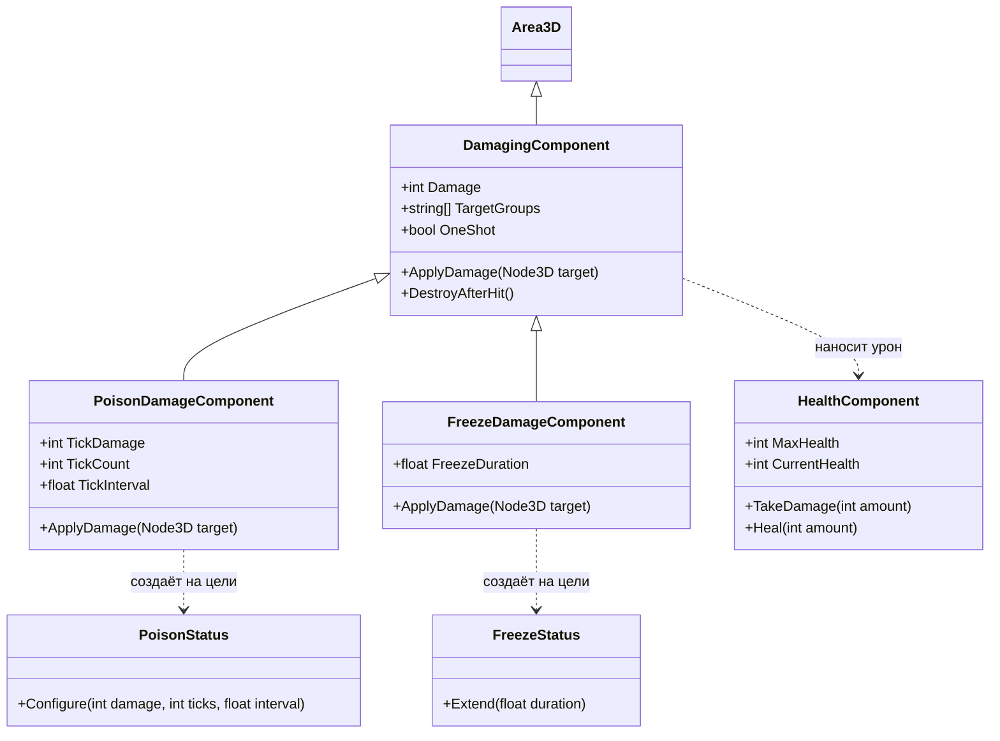

# Прототип Tower Defense — лабораторная работа 3

Проект на Godot 4.7 и C# (.NET 8). Игрок защищает ядро базы: двигается, стреляет и строит башни, пока с краёв поля идут стрелковые враги и контактные ползуны. Применена композиция: обнаружение целей, движение, стрельба, здоровье и урон вынесены в отдельные узлы.

## Запуск и управление

Откройте `project.godot` в версии Godot с поддержкой .NET, соберите C#-проект и запустите главную сцену `scenes/main.tscn` (`F6`) или проект (`F5`). Для проверки C# отдельно подходит `dotnet build практика3годот.csproj`.

| Клавиша | Действие |
| --- | --- |
| WASD | Движение игрока |
| Мышь | Поворот игрока и направление выстрела |
| ЛКМ или пробел | Стрельба |
| B | Показать призрачную башню; повторно нажать для строительства |
| 1 / 2 / 3 при строительстве | Выбрать обычную / ядовитую / ледяную башню |
| Esc при строительстве | Отменить строительство |

Призрак зелёный, когда место свободно, и красный, когда оно занято или находится за пределами поля. Башни ставятся без затрат ресурсов. Здоровье игрока и ядра, число врагов и сообщения показаны в верхней части экрана. После уничтожения ядра или игрока игра заканчивается; после отражения всех врагов объявляется победа.

## Структура сцен

```text
main.tscn (Main: GameManager)
├── Ground / Camera3D / DirectionalLight3D
├── Core (core.tscn)
│   └── HealthComponent
├── Player (player.tscn: PlayerController)
│   ├── HealthComponent
│   └── TowerPreview (призрачная башня)
├── TowerStandard (tower.tscn)
│   ├── HealthComponent
│   ├── VisibilityComponent
│   └── ShootComponent → bullet.tscn
├── TowerPoison (poison_tower.tscn)
│   ├── HealthComponent
│   ├── VisibilityComponent
│   └── ShootComponent → poison_bullet.tscn
├── TowerFreeze (freeze_tower.tscn)
│   ├── HealthComponent
│   ├── VisibilityComponent
│   └── ShootComponent → freeze_bullet.tscn
├── EnemyNorth / EnemyEast (enemy_tower.tscn)
│   ├── HealthComponent
│   ├── VisibilityComponent
│   ├── MoveComponent
│   └── ShootComponent → enemy_bullet.tscn
└── CrawlerWest / CrawlerSouth (crawler.tscn: Crawler)
	├── HealthComponent
	└── DamagingComponent (контактный урон)
```

`GameManager` добавляет ещё десять врагов по таймеру, чередуя стрелковых врагов и ползунов. Созданные игроком башни добавляются в `Main`. Враги и башни автоматически регистрируются менеджером через группы.

| Сцена | Назначение |
| --- | --- |
| `scenes/main.tscn` | Поле, камера, свет, исходные объекты; корень управляет матчем. |
| `scenes/core.tscn` | Неподвижное жёлтое ядро в форме пирамиды с запасом здоровья; его гибель завершает игру. |
| `scenes/player.tscn` | Зелёный управляемый персонаж с коллизией и здоровьем. |
| `scenes/tower.tscn` | Обычная зелёная башня со стандартным снарядом. |
| `scenes/poison_tower.tscn` | Башня с зелёным корпусом и фиолетовой верхушкой; её снаряд отравляет врага. |
| `scenes/freeze_tower.tscn` | Угловатая голубая башня с кристаллом; её снаряд временно останавливает врага. |
| `scenes/enemy_tower.tscn` | Красный стрелковый враг, движется к базе и стреляет при обнаружении цели. |
| `scenes/crawler.tscn` | Красный ползун, преследует ближайшее дружественное тело и наносит периодический контактный урон. |
| `scenes/bullet.tscn`, `poison_bullet.tscn`, `freeze_bullet.tscn`, `enemy_bullet.tscn` | Снаряды разных цветов с общим скриптом движения `Bullet` и разными компонентами урона. |

Дружественные тела входят в группу `player`, башни дополнительно в `tower`, ядро в `core`; враги входят в `enemy`. Коллизионный слой 1 — земля, 2 — дружественные тела, 3 (значение 4) — враги. Компоненты обнаружения и урона используют маски слоёв и проверяют группы при контакте. Цвета помогают различать стороны: зелёные башни и игрок, красные враги, жёлтое ядро; специализированные снаряды выделяются своим цветом.

## Классы и ответственность



| Скрипт | Назначение |
| --- | --- |
| `scripts/GameManager.cs` | Singleton-подобный `Instance`, HUD, волны, учёт оставшихся врагов, победа и поражение. |
| `scripts/PlayerController.cs` | Движение, поворот по мыши, ручная стрельба, выбор и постановка башен с призраком и проверкой места. |
| `scripts/HealthComponent.cs` | Здоровье, получение урона, лечение, удаление владельца при смерти. |
| `scripts/VisibilityComponent.cs` | Сферическое обнаружение тел целевой группы и выбор ближайшей цели. |
| `scripts/MoveComponent.cs` | Движение стрелкового врага к центру поля, остановка при появлении цели. |
| `scripts/ShootComponent.cs` | Автоматическое наведение на цель и создание снаряда с интервалом. |
| `scripts/Bullet.cs` | Только перемещение и ограничение времени жизни снаряда. Логики нанесения урона здесь нет. |
| `scripts/DamagingComponent.cs` | Общий компонент урона `Area3D`: целевые группы, урон при контакте, повторный интервал и удаление после одноразового удара. Используется и снарядами, и ползуном. |
| `scripts/PoisonDamageComponent.cs`, `scripts/PoisonStatus.cs` | Наследник базового урона добавляет на цель статус; тот периодически снимает здоровье. |
| `scripts/FreezeDamageComponent.cs`, `scripts/FreezeStatus.cs` | Наследник базового урона временно блокирует движение `MoveComponent` или `Crawler`, затем восстанавливает его. |
| `scripts/Crawler.cs` | Поиск ближайшей дружественной цели и движение к ней. Сам урон реализует дочерний `DamagingComponent`. |

Поток попадания: `ShootComponent` или игрок создаёт `Bullet`; внутри снаряда `DamagingComponent` определяет подходящее тело по группе, вызывает `ApplyDamage()`, а тот обращается к `HealthComponent`. Для яда и заморозки производный компонент добавляет статус на поражённого врага. Ползун использует тот же базовый `DamagingComponent` без снаряда и с повторением урона при контакте.

## Условия матча

Башни можно строить свободно, если выбранная точка не занята. После появления всех дополнительных врагов и уничтожения оставшихся игра показывает победу; гибель игрока или ядра показывает поражение и ставит сцену на паузу.

## Дополнительные файлы

`PROJECT_OVERVIEW.md` — краткий рабочий обзор состояния проекта для следующих правок. `project.godot` задаёт главную сцену, настройки Godot и группы. `.csproj` и `.sln` относятся к C#-сборке. `.godot/` содержит локальный кэш редактора.
